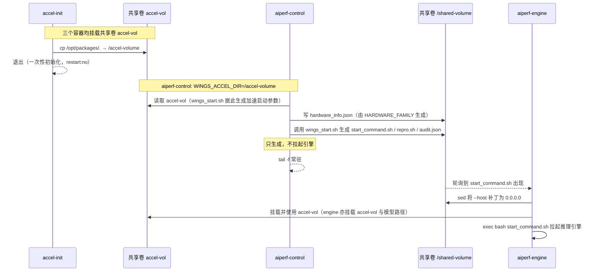

# AI Perf 示例部署（适配 wings-infer-pro）

本目录是 AI Perf 在新版 **wings-infer-pro**（Wings Control 重构版）上的 Docker Compose
示例，合并自原独立代码仓（AIPerf），保留原有使用习惯：

- 以 **tar 镜像包 + docker-compose.yaml + env 文件** 交付；
- 用户适配新模型**只需修改 env 配置项**（模型名/路径/端口/启动参数），无需改其他文件。

## 目录结构

```
ai_perf/
└── example/
    ├── docker-compose-npu/   # 昇腾 NPU (vllm-ascend) 示例
    │   ├── docker-compose.yaml
    │   ├── env.example
    │   ├── aiperf-control-entrypoint.sh
    │   └── aiperf-engine-entrypoint.sh
    └── docker-compose-gpu/   # NVIDIA GPU (vllm) 示例
        └── (同上，runtime 换为 nvidia)
```

## 与新版 wings-infer-pro 的适配点

相对旧版 AI Perf 仓库，本示例做了以下对齐（与康雯验证过的 Wings 重构版路径一致）：

| 旧版行为 | 新版适配 |
|---|---|
| `wings_start.sh` 透传 `--enable-speculative-decode` | 新 CLI 已移除该 flag；改为通过环境变量 `ENABLE_SPECULATIVE_DECODE` / `ENABLE_SPARSE` 交给 SmartAccel 子系统消费 |
| 无 hardware_info 概念 | 新框架按 `hardware_family` 定位配置目录（`config/engines/<engine>/<version>/<family>/models/`）；control 入口根据 env 中 `HARDWARE_FAMILY` 自动生成 `/shared-volume/hardware_info.json` |
| 引擎版本只做展示 | `ENGINE_VERSION` 环境变量被新框架用于选择配置资产版本树（如 `vllm-ascend/v0.18.0`）。注意填**配置树中实际存在的版本目录**：框架按 `vX.Y.Z`（可含 rc 渠道，如 `v0.21.0rc1-20260709` → `v0.21.0rc`）匹配，引擎镜像 tag 可以比它更详细（`v0.18.0rc1` → 配置目录 `v0.18.0`）；未精确命中时会回退 latest 并告警 |
| `ENGINE_PORT` 由 control 显式下发 | 新框架中 `ENGINE_PORT` 是 backend 真实监听端口，`PORT`(=`CONTROL_PORT`) 是 proxy 对外端口，语义一致、保持下发 |

启动流程（三容器，与旧版一致）：

1. `accel-init`：把加速包镜像内 `/opt/packages/` 拷入共享卷 `accel-vol`；
2. `aiperf-control`：调用 `wings_start.sh` 生成 `start_command.sh` / `repro.sh` / `audit.json`
   到 `/shared-volume`（新版框架**只生成不拉起**引擎），随后常驻；
3. `aiperf-engine`：等待 `/shared-volume/start_command.sh` 出现，把 `--host` 补丁为
   `0.0.0.0` 后 `exec` 拉起推理引擎。

启动流程时序图：



## 快速开始

```bash
cd example/docker-compose-npu

# 1. 复制并按环境修改 env（模型路径 / NPU 卡号 / 端口等）
cp env.example env
vim env

# 2. （可选）核对 hardware_family 与引擎版本在 wings-control 镜像内有对应配置树：
#    config/engines/vllm-ascend/<ENGINE_VERSION>/<HARDWARE_FAMILY>/models/

# 3. 清理旧环境（如有）
docker-compose --env-file env -f docker-compose.yaml down -v

# 4. 启动
docker-compose --env-file env -f docker-compose.yaml up -d

# 5. 观察
docker-compose --env-file env -f docker-compose.yaml ps
docker-compose --env-file env -f docker-compose.yaml logs -f aiperf-control  # 生成阶段
docker-compose --env-file env -f docker-compose.yaml logs -f aiperf-engine  # 引擎拉起
```

服务就绪后：

- 对外推理接口：`http://<host>:${CONTROL_PORT}/v1/...`（proxy 层）
- 引擎直连（调试用）：`http://<host>:${ENGINE_PORT}`
- 健康检查：`http://<host>:${HEALTH_PORT}`
- 监控代理：`http://<host>:${MONITOR_PROXY_PORT}`

## 镜像来源

在 wings-infer-pro 仓库执行 `bash build/build.sh <版本号>` 产出
`Wings_infer_<版本>_<arch>.zip`（含 `Wings_accel_*.tar` 与 `Wings_control_*.tar`），
解压后：

```bash
docker load -i Wings_accel_<版本>_<arch>.tar    # → IMAGE_ACCEL
docker load -i Wings_control_<版本>_<arch>.tar  # → IMAGE_CONTROL
```

引擎镜像 `IMAGE_ENGINE` 从官方仓获取（vllm / vllm-ascend）。

## env 配置说明

所有可修改参数集中在 `env` 文件；改完重新 `up -d` 生效。

### 用户通常需要修改的参数

| 参数 | 说明 |
|---|---|
| `MODEL_NAME` / `MODEL_PATH` | 模型名称（用于配置匹配 + served-model-name）与宿主机模型路径（宿主机与容器内路径一致） |
| `XPU_VISIBLE_DEVICES` | 使用的设备卡号（NPU: 逗号分隔 davinci 逻辑号；GPU: NVIDIA 逻辑号） |
| `ENGINE_PORT` / `CONTROL_PORT` / `HEALTH_PORT` / `MONITOR_PROXY_PORT` | 端口，多服务共存时必改 |
| `HARDWARE_FAMILY` | 硬件族标识，用于 wings-infer-pro 配置目录定位（如 `ascend-a2` / `h100`），必须与镜像内 `config/engines/<engine>/<version>/` 下的目录名一致 |

### 引擎与框架参数（按需调整）

| 参数 | 默认 | 说明 |
|---|---|---|
| `ENGINE` | `vllm-ascend` / `vllm` | 底层引擎模式 |
| `ENGINE_VERSION` | 与镜像 tag 一致 | 选择 wings-infer-pro 配置资产版本树 |
| `DEVICE_COUNT` | 2 / 1 | 使用卡数 |
| `QUANTIZATION` | `ascend`（NPU） | 量化方案，W8A8/W4A4 设为 `ascend` |
| `GPU_MEMORY_UTILIZATION` | 0.9 | 显存利用率 |
| `INPUT_LENGTH` / `OUTPUT_LENGTH` | 16384 | 输入/输出长度 |
| `MAX_NUM_SEQS` | 64 | 最大并发序列数 |
| `MAX_NUM_BATCHED_TOKENS` | （空） | 可选，每批最大 token 数 |
| `KV_CACHE_DTYPE` / `BLOCK_SIZE` / `DTYPE` | auto / 128 / auto | KV cache 与精度参数 |
| `TRUST_REMOTE_CODE` | true | 是否信任远程代码 |
| `SHM_SIZE` | 16g | 引擎容器共享内存 |
| `SERVICE_SUFFIX` | qwen | 容器名后缀，便于 `docker ps` 区分 |

### 特性开关（默认 false，按需开启）

| 参数 | 说明 |
|---|---|
| `ENABLE_ACCEL` | 启用 wings-accel 加速包（注入 `WINGS_ENGINE_PATCH_OPTIONS`） |
| `ENABLE_REASON_PROXY` | 启用 Reason 代理 |
| `ENABLE_SPECULATIVE_DECODE` | 启用投机解码（由 SmartAccel 子系统消费） |
| `ENABLE_SPARSE` | 启用稀疏加速（由 SmartAccel 子系统消费） |

### 适配新模型

只需修改 env 中 `MODEL_NAME`、`MODEL_PATH`、端口与启动参数（如长度/并发），不改任何
脚本文件。若模型在 wings-control 配置树中无专属 recipe，框架会用
`default_model.yaml` 兜底并把每个参数的来源写入 `audit.json`（可在
`/shared-volume` 挂载卷中查看）。

## 已验证基线

- 昇腾 NPU + `vllm-ascend`（`ascend-a2` 硬件族，Qwen3-32B W8A8）全流程验证可行
  （与康雯测试 Wings 重构版时的 Docker Compose 方案一致）。
