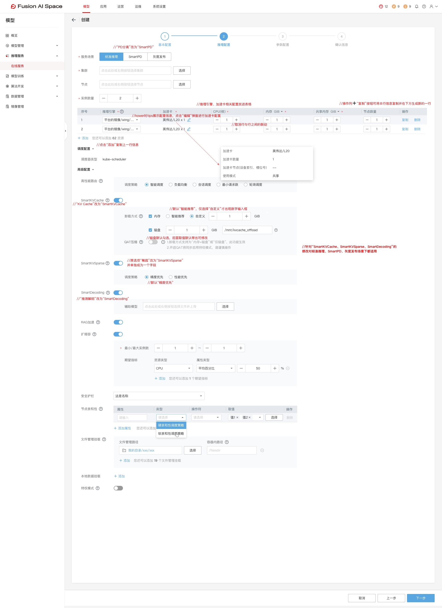
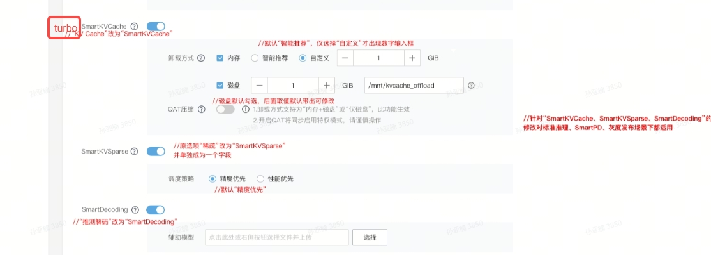
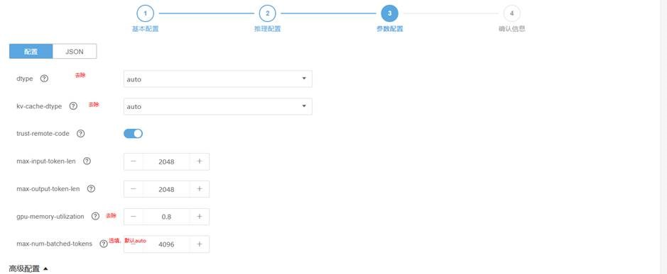

# Maas侧与wins-control侧交互接口参数锲约说明

本文定义 MaaS 下发给 wings-control 的参数契约。标准推理和 PD 分离共用同一套
CLI/env 规则；PD 只增加必要的角色、拓扑和 placement 输入，不引入同义字段。

## 传参原则

### 字段填写类型

| 类型 | 下发规则 |
|---|---|
| 必填 | MaaS 必须填写并下发 |
| 条件必填 | 条件成立时必须下发；条件不成立时不下发 |
| auto 选填 | 用户选择时下发；用户未选择时不下发 |

“条件必填”和“auto 选填”的不下发语义不同：条件必填表示控制条件未成立，auto 选填表示
用户没有选择该项。消费侧只按父开关或明确条件判断，不逐字段推测业务含义。

### 传递方式

- `--` 开头的参数通过 CLI 下发，主要对应页面可配置项。
- 不带 `--` 的参数通过环境变量下发，主要对应 MaaS 运行时上下文和特性开关。
- 投机推理、KV 卸载、KV 稀疏和 PD 分离的运行时上下文通过环境变量表达。

### 开关规则

1. CLI 开关 `--enable-xxx` 为 auto 选填：下发表示 `true`，不下发表示 `false`。
2. 环境变量总开关 `ENABLE_xxx` 为必填：MaaS 下发 `true` 或 `false`。
3. 父开关为 `false` 或 CLI 开关未下发时，其下级条件必填字段不下发。
4. 父开关为 `true` 时，下级字段按各自类型下发。
5. 开关字段只表达开关语义，不同时承载其它配置含义。

## PD 分离补充原则

标准推理下发 `PD_ROLE=none`。PD Prefill 下发 `PD_ROLE=P`，PD Decode 下发
`PD_ROLE=D`。

PD 分离分为两类：

| 类型 | 部署约束 | MaaS 关键输入 |
|---|---|---|
| 普通 PD | 固定 1P1D；P/D 各一个 Pod、DP=1；TP=`device-count` | `PD_ROLE`、`RANK_IP`、`--device-count`；不下发六个显式 PD topology 字段 |
| PD 大 EP | 支持 mPnD；P/D 两侧可使用不同的并行规格 | `PD_ROLE`、六个显式 PD topology 字段；跨 Pod 时下发完整 placement |

六个显式 PD topology 字段专用于 **PD 大 EP**：

- `PD_INDEX`
- `PD_PREFILL_DP_SIZE`
- `PD_PREFILL_TP_SIZE`
- `PD_DECODE_DP_SIZE`
- `PD_DECODE_TP_SIZE`
- `DP_SIZE_LOCAL`

其中，`PD_PREFILL_DP_SIZE` 和 `PD_DECODE_DP_SIZE` 由用户在 MaaS 页面填写，用户手册提供
已验收 recipe 的推荐值，但允许用户填写其它正整数。其余四个字段由 MaaS 自动生成并下发，
不要求用户填写。非推荐 topology 只保证通过校验后生成命令，不代表
目标引擎已经过运行验收。

这六个字段必须全部下发或全部不下发。部分下发属于契约错误。普通 PD 不下发，PD 大 EP
全部下发。

PD 参数的责任边界如下：

| 类型 | 示例 | 责任边界 |
|---|---|---|
| 角色与 placement | `PD_ROLE`、`RANK_IP`、`MASTER_IP`、`NODE_IPS` | MaaS 按当前 Pod 所属 logical Instance 下发 |
| PD 大 EP 拓扑 | 上述六个显式字段 | MaaS 按 deployment plan 下发 |
| recipe 内部参数 | KV port、DP RPC port、connector identity、EP/MTP 和其它模型固定参数 | MaaS 不下发，由 wings-control 按 exact recipe 生成 |

MaaS 负责计算并下发 PD 大 EP 六字段；wings-control 原样消费这些值，不重新推荐、计算或
修正并行度。字段缺失、格式错误或相互矛盾时，wings-control 直接报错，不使用默认值或回退
topology。

PD 大 EP 中，MaaS 必须保证同一角色的 logical Instance 使用统一规格：所有 Prefill
Instance 的成员 Pod 数相同，并共用同一个 `PD_PREFILL_DP_SIZE`；所有 Decode Instance 的
成员 Pod 数相同，并共用同一个 `PD_DECODE_DP_SIZE`。同一角色各 Pod 的 `device-count` 也必须
一致。Prefill 与 Decode 两侧的成员 Pod 数、DP 和 `device-count` 可以不同。这些约束由 MaaS
页面和部署逻辑保证，用户不能按单个 Instance 分别配置。

既有 smart/feature 开关继续按标准推理字段下发，不新增 PD 专属副本。PD 所需字段及下发
条件见“推理配置（第二页）”。

## 基本配置（第一页）


|变量|必填/条件必填/auto选填|类型|含义|取值说明|
|---|---|---|---|---|
|\-\-model\-name|必填|str|模型名称||
|\-\-model\-path|必填|str|模型路径||
|\-\-port|必填|int|wings proxy 监听端口|标准推理由 MaaS 按既有规则下发；PD 首期固定下发 `18000`。该值不是 engine backend 端口|


## 推理配置（第二页）

本页以环境变量为主，描述 MaaS 与 wings-control 的交互输入；模型 YAML 中的 export/sysctl 等引擎层环境变量不属于本表。


### Smart 配置示意（FOAI）



### Smart 配置示意（TOKEN BOX）




|变量|必填/条件必填/auto选填|类型|含义|取值说明|
|---|---|---|---|---|
|\-\-engine|必填|str|引擎类型|使用连接符，例如 `vllm-ascend`、`vllm`、`sglang`；PD 是否支持以具体引擎、模型配置和验收结果为准|
|`ENGINE_VERSION`|必填<br>|str|引擎版本字符串|MaaS 下发所选引擎的配置兼容版本。wings-control 按大小写无关的最长目录前缀匹配配置；例如配置目录为 `v0.23.0` 时，`v0.23.0`、`v0.23.0rc` 和 `v0.23.0_a3_202608131112` 均命中该目录。PD 未命中时直接报错；标准推理保留既有 warning 和回退行为。audit 记录下发值与最终命中的配置目录。|
|\-\-distributed<br>|auto选填|bool|当前 logical Instance 是否跨 Pod 的判定开关<br>|**必须按“当前 logical Instance 是否跨 Pod”判断，不能按整个 PD 推理服务的 Pod 总数判断**。标准推理 multi-node 与 PD 跨 Pod Instance 下发 true；标准推理 single-node 与 PD 单 Pod Instance 不下发。例：1P1D 共 2 个 Pod，但 P 与 D 各自是单 Pod Instance，故两个 Pod 都不下发 `--distributed`；若 P0 横跨 2 个 Pod、D0 单 Pod，则只有 P0 的 2 个 Pod 下发。`--distributed` 不是 PD 开关，PD 由 `PD_ROLE` 判定；wings-control 收到 `RANK_IP` 不会因 `--distributed=false` 进入 multi-node|
|`MASTER_IP`<br>|条件必填<br>|str|当前运行域的主节点 Pod IP|标准推理：`--distributed` 下发时必填。PD 跨 Pod：必填，值为当前 logical Instance 的 `NODE_IPS[0]`。**PD 单 Pod：生产者契约是“不下发”（见说明 10），不是 auto选填**；wings-control 兼容接收，但若下发必须满足 `MASTER_IP == RANK_IP`|
|`RANK_IP`<br>|条件必填|str|当前 Pod IP|标准推理：`--distributed` 下发时必填。PD：必填（endpoint 需要本 Pod IP）；跨 Pod 时必须在当前 logical Instance 的 `NODE_IPS` 中唯一出现，单 Pod 时缺失 `MASTER_IP/NODE_IPS` 由它派生|
|`NODE_IPS`|条件必填<br>|str|当前运行域的有序成员 Pod IP 列表|标准推理：`--distributed` 下发时必填。PD 跨 Pod：必填，只包含当前 logical Instance 的成员。**PD 单 Pod：生产者契约是“不下发”（见说明 10，非 auto选填）**；wings-control 兼容接收，但若下发必须满足 `NODE_IPS == [RANK_IP]`|
|\-\-device\-count|必填|int|当前 Pod 分配给本 workload 的卡数|不是 deployment 或集群总卡数。普通 PD 和 PD 大 EP 均由 MaaS 按各自场景的资源规则下发。|
|`AVAILABLE_POD_MEM_SIZE`<br>|必填|int<br>|pod可用内存大小<br>|数值xx  单位/GB<br>注：消费方目前是为kv卸载，以后可能为其他的特性消费|
|`ENABLE_SPECULATIVE_DECODE`<br>|必填<br>|bool|投机推理开关（smart 一级）<br>|true/false<br><br>注：<br>wings-control 兼容未下发场景，默认按 false 处理|
|`SPECULATIVE_DECODE_MODEL_PATH`|条件必填|str|草稿模型路径|条件：`ENABLE_SPECULATIVE_DECODE`=true 时必填（具体路径或none），=false 时不下发|
|`ENABLE_SPARSE`<br>|必填<br>|bool|kv稀疏开关（smart 一级）|true/false<br><br>注：<br>wings-control 兼容未下发场景，默认按 false 处理|
|`SPARSE_LEVEL`<br>|条件必填<br>|enum|稀疏模式<br>|枚举值：accuracy\_first、performance\_first<br><br>条件：`ENABLE_SPARSE`=true 时必填，=false 时不下发|
|`ENABLE_KV_OFFLOAD`<br>|必填<br>|bool<br>|kv卸载开关<br>（smart 一级）|true/false<br>属于smart 一级开关（它控制2个smart二级开关`ENABLE_KV_MEM_OFFLOAD`和`ENABLE_KV_DISK_OFFLOAD`）<br><br>注：<br>wings-control 兼容未下发场景，默认按 false 处理|
|`ENABLE_KV_MEM_OFFLOAD`<br>|条件必填<br>|`bool`<br>|`kv内存卸载开关`（smart 二级）|`true/false`<br><br>条件：`ENABLE_KV_OFFLOAD`=true 时必填，=false 时不下发|
|`KV_MEM_OFFLOAD_SIZE`<br>|条件必填|`str`<br>|`kv卸载内存大小`<br>|`字符串"auto" 或者 数值"xx" `<br>`（数值"xx"对应单位/GB，其中字符串"auto"表示智能推荐）`<br><br>条件：`ENABLE_KV_MEM_OFFLOAD`=true 时必填，=false 时不下发|
|`ENABLE_KV_DISK_OFFLOAD`<br>|条件必填<br>|bool<br>|磁盘卸载开关（smart 二级，还控制三级`ENABLE_KV_QAT`）|true/false<br><br>条件：`ENABLE_KV_OFFLOAD`=true 时必填，=false 时不下发|
|`KV_DISK_OFFLOAD_PATH`<br>|条件必填<br>|str<br>|磁盘路径<br>|条件：`ENABLE_KV_DISK_OFFLOAD`=true 时必填，=false 时不下发|
|`KV_DISK_OFFLOAD_SIZE`<br>|条件必填<br>|int|kv卸载磁盘大小<br>|数值xx 单位/GB<br><br>条件：`ENABLE_KV_DISK_OFFLOAD`=true 时必填，=false 时不下发|
|`ENABLE_KV_QAT`<br>|条件必填|bool|QAT开关（smart 三级）<br>|true/false<br><br>条件：`ENABLE_KV_DISK_OFFLOAD`=true 时必填，=false 时不下发|
|`KV_QAT_COMPRESS_LEVEL`<br>|条件必填<br>|int<br>|QAT压缩等级|条件：`ENABLE_KV_QAT`=true 时必填，=false 时不下发|
|`KV_QAT_INSTANCE_NUM`<br>|条件必填|int|QAT设备数量|条件：`ENABLE_KV_QAT`=true 时必填，=false 时不下发|
|\-\-enable\-rag\-acc<br>|auto选填<br>|bool|RAG 加速开关|下发时表示 true，不下发时表示 false。它是 MaaS 与 wings-control 之间唯一正式 RAG 开关；不下发 `RAG_ACC_ENABLED`|
|`PD_ROLE`|必填|enum|推理角色|标准推理下发 `none`；PD Prefill 下发 `P`；PD Decode 下发 `D`|
|`PD_INDEX`|PD 大 EP 条件必填|int|当前 logical Instance 在本次 deployment generation 内的序号|MaaS 根据部署计划计算；从 0 开始全局唯一连续，全部 Prefill 在前、Decode 在后；同一 Instance 的全部成员 Pod 下发相同值|
|`PD_PREFILL_DP_SIZE`|PD 大 EP 条件必填|int|一个 Prefill logical Instance 的全局 DP size|用户在 MaaS 页面填写；手册提供 recipe 推荐值，也允许其它正整数|
|`PD_PREFILL_TP_SIZE`|PD 大 EP 条件必填|int|一个 Prefill DP replica 的 TP size|由 MaaS 自动生成并下发|
|`PD_DECODE_DP_SIZE`|PD 大 EP 条件必填|int|一个 Decode logical Instance 的全局 DP size|用户在 MaaS 页面填写；手册提供 recipe 推荐值，也允许其它正整数|
|`PD_DECODE_TP_SIZE`|PD 大 EP 条件必填|int|一个 Decode DP replica 的 TP size|由 MaaS 自动生成并下发|
|`DP_SIZE_LOCAL`|PD 大 EP 条件必填|int|当前 Pod 分配的 local DP replica 数|由 MaaS 自动生成并下发|
|\-\-enable\-smartqos<br>|auto选填<br>|bool<br>|优先级调度开关<br>|下发时，表示true<br>不下发时，表示false<br>|
|\-\-enable\-otlp\-traces<br>|auto选填<br>|bool<br>|OpenTelemetry 服务端点特性开关|下发时，表示true<br>不下发时，表示false|
|`OTLP_TRACES_ENDPOINT`<br>|条件必填<br>|str<br>|OpenTelemetry 服务端点，<br>eg: "127\.0\.0\.1:4317"<br>用于实现请求链路追踪。<br>|条件：\-\-enable\-otlp\-traces下发时必填；不下发时不下发<br>|
|\-\-enable\-metrics|auto选填<br>|bool|SGLang 指标监控开关|下发时，表示true<br>vLLM默认开启指标监控功能，无相关参数。<br>该参数仅针对SGLang镜像生效。|
|\-\-gpu\-usage\-mode|auto选填|str|指定gpu使用模式，aiSpace下发参数|默认 full。只加了参数，规避了参数较验错误，具体逻辑还未实现|

### PD 分离参数说明（第二页补充）

1. `logical Instance` 表示一个 Prefill 或 Decode backend instance，不等于 Pod。普通 PD 的
   P/D Instance 各包含一个 Pod；PD 大 EP 的一个 Instance 可以包含一个或多个 Pod。
2. 六个显式 PD topology 字段是 PD 大 EP 的原子参数组。普通 PD 全部不下发，PD 大 EP
   全部下发；部分下发直接失败。其中 P/D DP size 由用户填写，recipe 值是推荐值而非硬限制；
   其余四个字段由 MaaS 自动生成。
3. `PD_INDEX` 标识 logical Instance，不是 Pod index、DP rank 或 Pod 内进程序号。它从 0
   开始全局连续，Prefill 在前、Decode 在后。
4. 普通 PD 固定 1P1D、P/D DP=1、local DP=1，且 P/D `device-count` 相等并为正的 2 次幂。
   wings-control 按 `TP=device-count` 使用当前 Pod 的全部卡。
5. PD 大 EP 的 P/D DP、TP 描述单个同角色 Instance 的并行形状，`DP_SIZE_LOCAL` 表示当前
   Pod 的 local DP 数。P/D Instance 数量由 MaaS deployment plan 表达，不增加接口字段。
6. 单 Pod Instance 只下发 `RANK_IP`；跨 Pod Instance 下发 `--distributed`、`MASTER_IP`、
   `RANK_IP` 和 `NODE_IPS`。placement 只包含当前 logical Instance 的成员 Pod。
7. 普通 PD 的 engine endpoint 为 `RANK_IP:17000`。PD 大 EP 中，第 `i` 个 local DP rank 的
   endpoint 为 `RANK_IP:(17000+i)`，其中 `0 <= i < DP_SIZE_LOCAL`。`--port=18000` 是 wings
   proxy 端口，不是 engine backend 端口。
8. DP RPC port、KV port、connector 类型与 `engine_id` policy，以及模型特有的 EP/MTP 参数
   由 wings-control recipe 提供，不由 MaaS 下发。connector 配置中的 P/D DP、TP 使用 MaaS
   下发的六字段。既有 smart/feature 开关继续复用标准推理字段。

## 参数配置（第三页）




|变量|必填/条件必填/auto选填|类型|含义|取值说明|
|---|---|---|---|---|
|\-\-max\-num\-seqs|auto选填|int|同时处理的最大序列数||
|\-\-max\-num\-batched\-tokens|auto选填|int|单次 forward 最多处理的 token 总数||
|\-\-input\-length|必填|int|输入序列的最大长度限制||
|\-\-output\-length|必填|int|输出序列的最大长度限制||
|\-\-trust\-remote\-code|auto选填|bool<br>|是否信任并执行 HuggingFace 仓库中的自定义代码|注：<br>如果不传，wings\-control会告警|
|\-\-enable\-auto\-think\-choice|auto选填|bool|是否打开思考模式||
|\-\-enable\-auto\-tool\-choice|auto选填|bool|是否启用自动工具选择||

## /shared\-volume/hardware\_info\.json

```Plain Text
{
  "hardware_family": "rtx_pro_5000_72G",
  "device": "nvidia"
}
```
